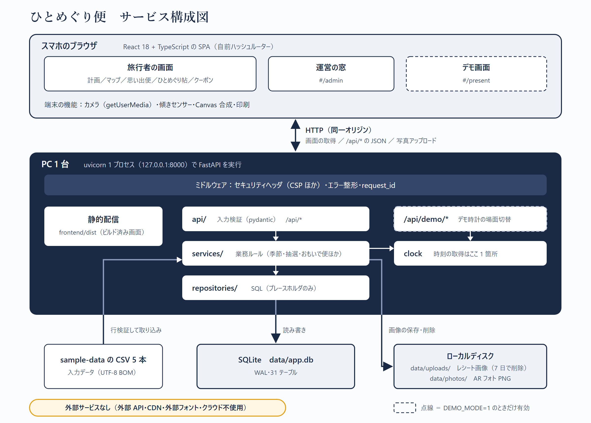
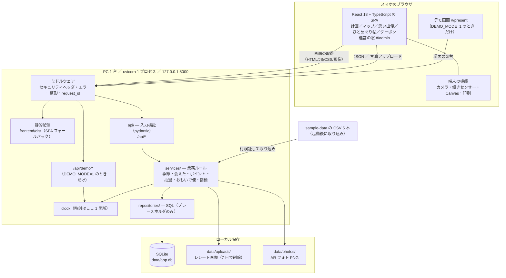

# 12 使用した技術アセット（実装方式・サービス構成図）

ひとめぐり便の技術構成をまとめたもの。版は `pyproject.toml` / `uv.lock` / `frontend/package.json` の固定値（2026-11-10 時点）。

## 1. 実装方式（ミドルウェア・技術構成）

### 1.1 ひとことで
**1 プロセス・1 ポートの Web アプリ。** FastAPI（uvicorn）が、ビルド済みの React 画面と JSON API を同じ `127.0.0.1:8000` から配る。DB は SQLite ファイル 1 つ。外部 API・CDN・外部フォント・クラウドサービスは使わない（ネットは依存のインストール時だけ）。

### 1.2 技術スタック一覧

| 層 | 採用技術 | 版 | 役割 |
|---|---|---|---|
| 画面 | React / React DOM | 18.3.1 | スマホ向け SPA。UI ライブラリなし（部品・絵は自前） |
| 画面 | TypeScript | 5.6.3 | 型検査（`tsc --noEmit` をビルド前に実行） |
| 画面 | Vite（+ @vitejs/plugin-react 4.3.4） | 5.4.11 | ビルド。成果物 `frontend/dist` を FastAPI が配信 |
| 画面 | 自前のハッシュルーター（`router.ts`） | — | `#/plan` `#/` `#/memories` など。ルーターライブラリなし |
| 画面 | 素の CSS（`styles.css`）＋ 自前 SVG | — | 藍染と和紙のデザイン。フォントは端末内蔵（Yu Mincho / Yu Gothic UI） |
| Web サーバ | uvicorn（ASGI サーバ） | 0.34.0 | HTTP の待ち受け。1 プロセス |
| アプリ基盤 | FastAPI（Starlette 0.41.3） | 0.115.6 | ルーティング、静的配信、ミドルウェア |
| 入力検証 | pydantic | 2.10.4 | リクエストの型・範囲の検証 |
| アップロード | python-multipart | 0.0.20 | レシート写真・AR フォトの multipart 受信 |
| 言語・実行環境 | Python | 3.12 系 | バックエンド。標準ライブラリ中心（sqlite3 / hashlib / csv / zlib など） |
| DB | SQLite（標準 `sqlite3`、ORM なし） | Python 同梱 | `data/app.db`。WAL、外部キー ON、busy_timeout 5 秒、31 テーブル |
| ファイル保存 | ローカルディスク | — | `data/uploads/`（レシート画像、7 日で自動削除）、`data/photos/`（AR フォト PNG） |
| パッケージ管理 | uv（Python）／ npm（Node.js 24） | — | `uv.lock` と `package-lock.json` で版固定（`npm ci`） |
| テスト | pytest 8.3.4 + httpx 0.28.1 ／ vitest 2.1.8 | — | API の通しテスト 40 件（`uv run pytest`） |
| 起動 | PowerShell `scripts/start.ps1` | — | npm ci → build → uv sync → uvicorn。`-Demo` で `DEMO_MODE=1` |

### 1.3 ミドルウェア・サーバ側の共通処理

| 仕組み | 実装場所 | 内容 |
|---|---|---|
| セキュリティヘッダ | `backend/app/security.py`（HTTP ミドルウェア） | CSP（すべて self、img は self+data+blob）、X-Content-Type-Options、X-Frame-Options: SAMEORIGIN、Referrer-Policy、Permissions-Policy（カメラは self のみ）、COOP。`/api/*` は `Cache-Control: no-store` |
| エラー整形 | `backend/app/errors.py` | すべて `{detail, code, request_id}` の JSON。例外の詳細はログだけ |
| 未知の API | `backend/app/main.py` | 存在しない `/api/*` は JSON 404 |
| 静的配信・SPA フォールバック | `backend/app/main.py` | `/assets` は StaticFiles、その他は `dist` 配下のファイルか `index.html`（dist の外は返さない） |
| DB 接続 | `backend/app/db.py` / `deps.py` | 接続 1 本を共有し、同期処理を 1 本ずつ実行（スレッド上限 1）。SQL はプレースホルダのみ |
| 時計 | `backend/app/clock.py` | 現在時刻の取得はここ 1 箇所。`DEMO_MODE=1` のときだけ DB のデモ時計を返す |
| デモ層の分離 | `backend/app/api/__init__.py` | `DEMO_MODE=1` のときだけ `/api/demo/*` を登録（0 のときは JSON 404） |
| 起動時処理 | `main.py` lifespan | スキーマ作成 → 固定マスタ投入 → サンプル写真作成 → 7 日超のレシート画像を削除 |

### 1.4 バックエンドの層

```
api/（pydantic で入力検証）→ services/（業務ルール）→ repositories/（SQL）→ SQLite
```

- `api/`: today / places / explore / wallet / photos / memories / survey / admin / operator / health（+ demo）
- `services/`: season・relationship・seeds（季節と約束）、points・lottery（ポイントと抽選）、letters・trips（おもいで便と旅）、photos・cleanup（画像）、metrics・survey・advice・forecast（運営の窓）、importer・dummy（CSV 取り込みとダミー）

### 1.5 ブラウザ側で使っている標準機能（ライブラリなし）

| 機能 | 用途 |
|---|---|
| `getUserMedia` | AR フォト・レシート撮影のカメラ（不可なら写真選択 → SVG 風景に切替） |
| Canvas（`toBlob` / `toDataURL`） | カメラ映像と SVG フレームを 1 枚の PNG に合成 |
| DeviceOrientation | 傾きに合わせた視差 |
| SVG | 地図・人物・マスコット・ルーレット・グラフをすべて自前で描画 |
| `fetch` | `/api/*` との通信（`api.ts` に集約） |
| `localStorage` | 表示設定（やさしい日本語など）の保存 |
| `window.print` + 印刷用 CSS | ハガキ判印刷 |

### 1.6 データ
- 入力: `C:\AI-Sprint\sample-data` の CSV 5 本（UTF-8 BOM）を行ごとに検証して取り込み（冪等、失敗行は理由付き）。
- 固定マスタ: 店 8・人 8・約束・商品・旅人の声。不足はシード 42 のダミー（`is_dummy` 付き）。
- 利用者は常に 8800001（認証なし・ローカル前提）。

## 2. サービス構成図（サービスアーキテクチャ）

### 2.1 構成図



図のファイル: `docs/img/service-architecture.png`（貼り付け用、2400×1720）／ `docs/img/service-architecture.svg`（元データ、自前 SVG）。以下は同じ内容の mermaid 版。



### 2.2 同じ内容のテキスト版（貼り付け用）

```
┌─ スマホのブラウザ ───────────────────────────────┐
│ React 18 + TypeScript の SPA（自前ハッシュルーター）          │
│  旅行者: 計画／マップ／思い出便／ひとめぐり帖／クーポン        │
│  運営  : 運営の窓 #/admin    デモ: #/present（DEMO_MODE=1）   │
│  端末機能: カメラ(getUserMedia)・傾き・Canvas 合成・印刷       │
└───────────────┬─────────────────────────┘
                │ HTTP（同一オリジン）: 画面の取得 ／ /api/* JSON ／ 写真アップロード
                ▼
┌─ PC 1 台: uvicorn 1 プロセス 127.0.0.1:8000（FastAPI）──────┐
│ ミドルウェア: セキュリティヘッダ(CSP ほか)・エラー整形          │
│  ├ 静的配信      frontend/dist（SPA フォールバック）           │
│  ├ api/          入力検証（pydantic）  /api/*                  │
│  │   └ /api/demo/*  … DEMO_MODE=1 のときだけ                   │
│  ├ services/     業務ルール（季節・会えた・ポイント・抽選・     │
│  │               おもいで便・指標）  ← clock（時刻は 1 箇所）  │
│  └ repositories/ SQL（プレースホルダのみ）                     │
└───────┬───────────────┬─────────────────┘
        ▼                              ▼
  SQLite data/app.db            ローカルディスク
  （WAL・31 テーブル）           data/uploads/ レシート画像（7 日で削除）
        ▲                        data/photos/  AR フォト PNG
        │ 行検証して取り込み（冪等）
  sample-data の CSV 5 本

外部サービス: なし（外部 API・CDN・外部フォント・クラウドは不使用）
```

### 2.3 構成のポイント
- **外部依存ゼロ**: 通信はブラウザ ↔ 自分の PC の 1 経路だけ。CSP も self のみで、外へ出る通信をブラウザ側でも止めている。
- **本体とデモ層の分離**: デモ時計と `/api/demo/*`、`#/present` は `DEMO_MODE=1` のときだけ有効。本体のコードは clock を通すだけでデモを意識しない。
- **整合性**: 抽選（ポイント減算・在庫・クーポン付与）は 1 トランザクション。「会えた」は DB の UNIQUE 制約で同日 1 回。
- **画像の扱い**: レシートは先頭バイトで形式判定、5MB 上限、SHA-256 で重複を拒否。画像は 7 日で削除し、数値だけ残す。
- **本番化するときに替える所**（今回の範囲外）: 認証の追加、SQLite → サーバ型 DB、画像 → オブジェクトストレージ、HTTPS 終端（カメラは localhost 以外では HTTPS が必須）。
